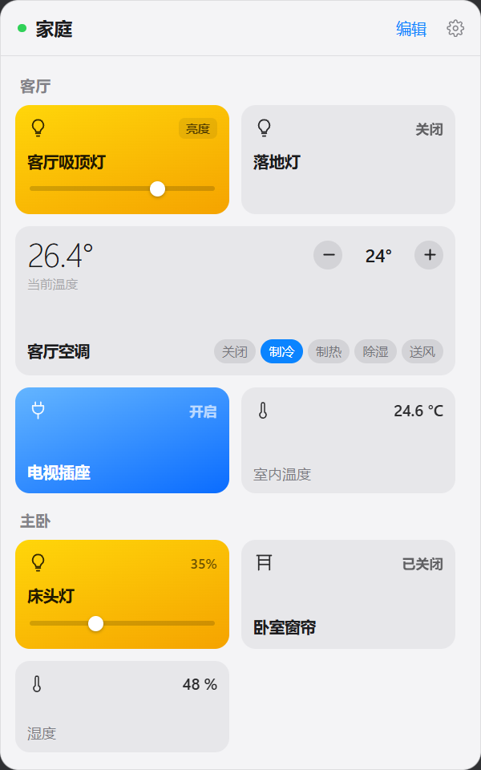

# HA Ctrl

Windows 托盘版的 Home Assistant 控制器。点一下托盘（或 MyDockFinder 之类的顶部状态栏）里的图标，就会弹出一个 macOS 风格的面板，直接控制家里的灯、空调和开关。



> macOS 风格为同一套磁贴布局，窗口使用 Windows 11 的系统 Acrylic 毛玻璃，透出并模糊桌面。

## 功能

- 两套界面风格，在设置里一键切换：
  - **macOS**：同一套磁贴布局，窗口使用 Windows 11 的系统 Acrylic 毛玻璃，透出并模糊桌面，带系统圆角与投影
  - **Windows**：不透明背景，圆角由样式绘制
- 默认只显示 Home Assistant「概览」仪表板里出现的实体；概览读不到时按类型自动筛选
- 托盘图标点击即弹出，以点击位置为锚点展开，失去焦点自动收起；全局快捷键 `Ctrl + Alt + H`
- 通过 WebSocket 连接 Home Assistant，实体状态实时同步，断线自动重连
- 自动读取你在 Home Assistant 里配置的房间（Area）并分组显示
- **灯光**：开关、亮度滑杆、色温滑杆（右上角切换亮度 / 色温）
- **空调**：当前温度、目标温度 ±、制冷 / 制热 / 自动 / 除湿 / 送风模式切换
- **开关、风扇、窗帘、场景、脚本**：点击触发
- **传感器**：只读展示数值与单位
- **编辑模式**：逐个房间增删实体（Windows 风格下还支持拖拽排序）；不在概览里的实体可以在这里手动加回
- 托盘右键菜单：重新连接、开机自启、退出

## 环境要求

- Windows 10 / 11
- Node.js 18 以上
- Home Assistant 2023.11 或更新版本（色温控制依赖 `color_temp_kelvin`）

## 下载

到 [Releases](https://github.com/YonimoC/HA-Ctrl-for-Windows/releases) 下载 `HA-Ctrl-1.0.0-win-x64.zip`，解压后运行 `HA Ctrl.exe`。这是免安装版本，程序会在系统托盘常驻。

> 安装包（NSIS）暂未提供，可自行 `npm run dist` 打包。

## 开发运行

```bash
npm install
npm run dev
```

首次打开后点右上角齿轮，填写：

- **服务器地址**：例如 `http://homeassistant.local:8123`
- **长期访问令牌**：在 Home Assistant 的「个人资料 → 安全 → 长期访问令牌」页面创建

## 打包

```bash
npm run dist
```

产物是 NSIS 安装包，输出在 `dist/`。

## 本地配置存放位置

配置住在 `%APPDATA%\HA Ctrl\`，**不在仓库里**：

- `server.json`：服务器地址与令牌，令牌使用 Electron `safeStorage`（Windows 上即 DPAPI）加密
- `dashboard.json`：面板的显示、隐藏与排序

删掉这个目录就等于恢复出厂设置。

## 目录结构

```
src/main/        主进程：托盘、弹窗窗口、Home Assistant WebSocket 客户端
src/preload/     contextBridge 暴露给渲染进程的 IPC 接口
src/renderer/    React 界面（面板、房间分组、各类实体卡片、设置页）
src/shared/      主进程与界面共用的类型定义和实体域名表
scripts/         图标生成脚本
resources/       托盘与应用图标
```

## 实现说明

- 实体、房间信息分别来自 `get_states`、`area_registry/list`、`device_registry/list`、`entity_registry/list`
- 状态更新走 `subscribe_events`，只推送发生变化的实体，不会整表重发
- 服务调用统一走 WebSocket 的 `call_service`
- 弹窗定位会采样光标轨迹，回溯出真正的点击时刻，以兼容 MyDockFinder 这类转发点击的菜单栏工具

## 说明

非 Home Assistant 官方项目，与 Home Assistant 组织无关。
